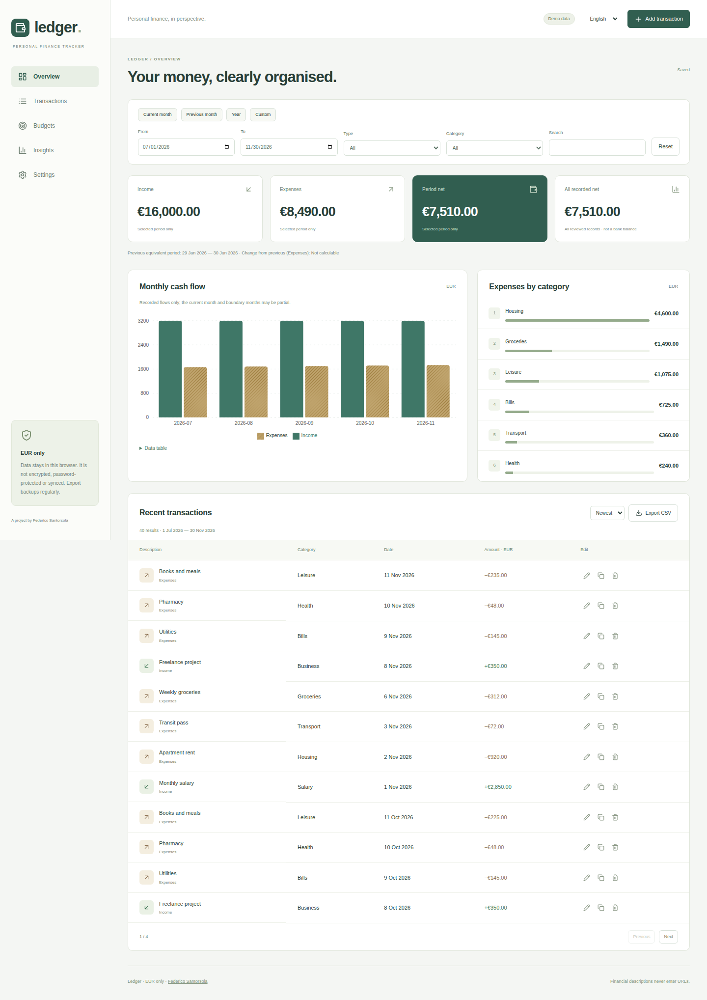
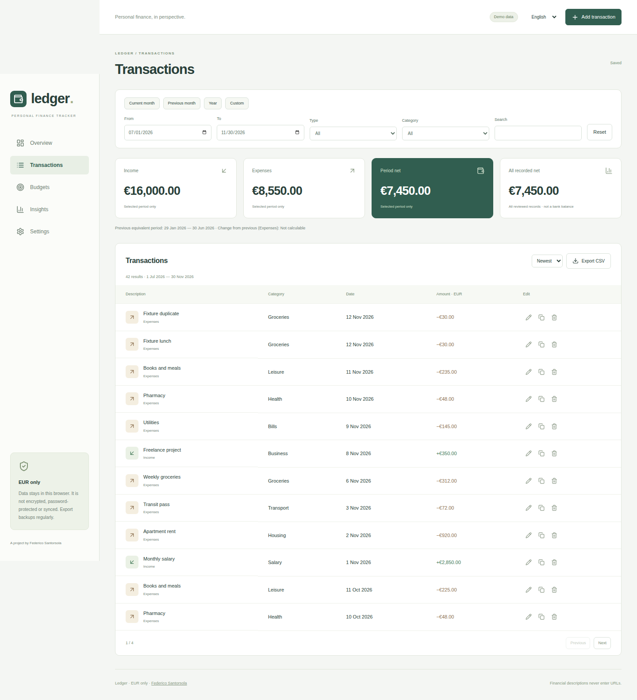
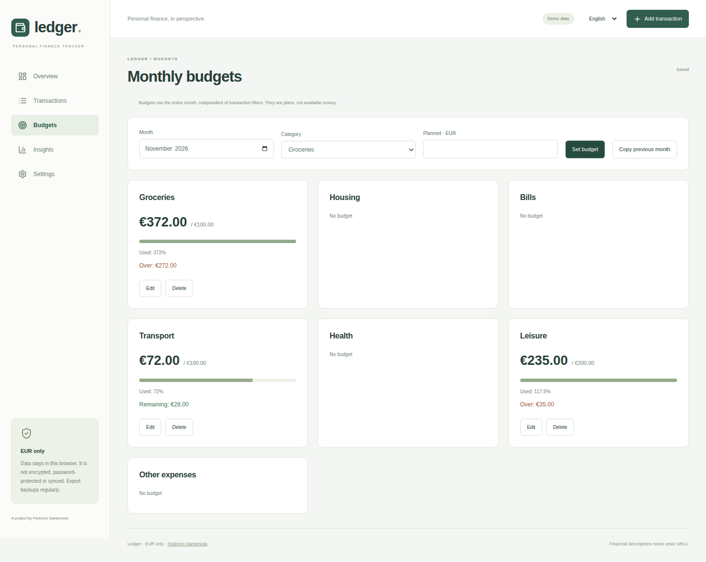
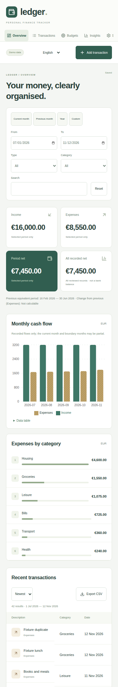

# Ledger — Personal Finance Tracker

A local-first register for everyday income, expenses and monthly category budgets. Ledger turns recorded flows into a clear overview without bank connections, accounts or a backend. Built by [Federico Santorsola](https://github.com/Frero0).

English by default, with a persistent Italian interface. EUR is the only currency: changing language changes formatting, never the amounts.



## What you can do

- **Overview:** selected-period income, expenses and net result; a separately labelled cumulative result; equal-length previous-period comparison; monthly flow chart and ranked expense categories.
- **Transactions:** create, edit, review a duplicate, delete and undo the last deletion. Search descriptions, filter by date/type/category, sort and paginate. Overview, Insights, the list and CSV share the same selection.
- **Budgets:** plan an expense amount per category/month, inspect actual spending, remaining amount and overruns above 100%. Explicitly copy the previous month's budgets. Budgets always use the full calendar month, independently of list filters.
- **Insights:** interactive chart tooltips, a labelled legend and a tabular alternative. Partial months and missing comparison denominators are explained.
- **Optional text or voice entry:** preview recognized fields, apply them to the form, then save manually. Typed phrases use exactly the same parser and work without a microphone.
- **Data tools:** export filtered CSV; download a versioned JSON backup; validate and preview a complete replacement before restoring; explicitly delete this app's local data.
- **Safe start:** choose **Try demo** or **Start empty**. Demo mode stays visibly labelled and never merges into an existing register.

This is a personal flow register, not a bank balance, accounting system or financial advice service. No banking, cloud sync, authentication, AI assistant or financial recommendations are implemented.

## Interface

| Transactions                                                            | Monthly budgets                                                        |
| ----------------------------------------------------------------------- | ---------------------------------------------------------------------- |
|  |  |



All screenshots are captured from the real production build in an isolated browser using demo/fixture records. No personal financial data is used.

## Run locally

Requirements: **Node.js 22.22.1 or newer**, npm and a current browser. The exact dependency graph is committed in `package-lock.json`.

```bash
npm ci
npm run dev
```

Open **http://localhost:3024/**. Select **Try demo** to explore the deterministic July–November 2026 dataset, or **Start empty** for your own register. The demo dates are fictional sample records, not a claim about current finances.

```bash
npm run typecheck
npm run lint
npm test
npm run build
npm run preview
```

`npm test -- --all` combines typecheck, lint, unit tests and production build. There are no runtime API keys, remote fonts, external data requests or environment secrets. After installation, the app can be built and served without an internet connection; reopening the app still requires its static server. Ledger does not install a service worker or promise an offline app shell.

## Try the main workflow

1. Choose demo, then switch between Overview, Transactions, Budgets and Insights.
2. Add an expense, edit it, duplicate it for review, delete it and use Undo.
3. Change the common filters and export the resulting CSV.
4. Set a monthly budget or explicitly copy the previous month. Changing transaction filters does not change budget spending.
5. In Settings, download a backup. Upload it to see the record/budget count before confirming replacement. Invalid files leave the current dataset intact.
6. Change English / Italiano in the header. The selection survives reload and keeps amounts, budgets and records unchanged.

Views reopen through `?view=overview`, `transactions`, `budgets`, `insights` or `settings`. Filter descriptions and other financial data never go into the URL. Filters themselves are session state; shared links select a view, not somebody else's financial records.

## Data model and calculations

`ledger:v2` contains a version-2 dataset:

```json
{
  "version": 2,
  "mode": "personal",
  "transactions": [
    {
      "id": "stable-record-id",
      "type": "expense",
      "cents": 2450,
      "category": "groceries",
      "date": "2026-11-12",
      "description": "Weekly groceries"
    }
  ],
  "budgets": [{ "month": "2026-11", "category": "groceries", "cents": 30000 }],
  "preferences": { "language": "en" }
}
```

Amounts are positive integer cents; the type determines their contribution to the result. Inputs allow a dot or comma decimal separator, at most two decimal places and a maximum of EUR 99,999,999.99. Dates are validated civil dates from 1900 through 2100, without implicit device-timezone conversion. Relative phrases use the user's local calendar. Categories have immutable, language-independent IDs.

Pure functions calculate totals, monthly series, distributions, equal-day previous ranges and budget usage. No shared category accumulator is changed during rendering. The cumulative result includes all reviewed records; period metrics include only the selected records. An unavailable previous-period denominator is shown as not calculable, never as an invented percentage. Recorded months may be incomplete; charts explicitly warn about partial periods. A budget is a plan, not spendable money.

### Persistence and migration

Data is stored in the current browser origin's `localStorage`, **unencrypted**, without a password or synchronization. Different ports, browsers and deployed domains have separate storage. Keep external backups: clearing browser data can remove everything.

The old `fs-bilancio-23` array is validated in full before migration. Its exact original text is copied to `ledger:original-legacy` **before** version 2 is written; the old key is retained. The recovery copy can be downloaded in Settings. IDs, dates, amounts and original category names are preserved. Every legacy category is explicitly marked for review; those records remain visible but are excluded from totals until the user edits and assigns a current category. This prevents legacy savings/deposits from silently becoming new income.

Invalid persisted data is not overwritten by an empty register. A recovery screen offers the original text for export and requires an explicit destructive reset. A blocked migration also leaves its original available. Storage denial or quota failure produces a warning; new changes remain in memory and can be exported, rather than being reported as saved. Delete local data removes only Ledger's three keys after confirmation.

### Backup and CSV

JSON backups contain transactions, budgets, mode and language. Restore supports only version 2, validates all rows and unique IDs/budget keys, and rejects incompatible categories, invalid dates, amounts or preferences. Limits are 10 MiB per uploaded file, 50,000 records and 12,000 budgets. Replacement is explicit and atomic in memory; there is no automatic merge. If browser persistence fails, the session remains usable and warns you to export it.

CSV exports the currently filtered, sorted rows, with UTF-8 BOM, semicolon delimiter, quoted fields and doubled embedded quotes. Headers follow the selected language. English: `id`, `type`, `amount_eur`, `category`, `date`, `description`, `review_required`; Italian: `id`, `tipo`, `importo_eur`, `categoria`, `data`, `descrizione`, `da_rivedere`. Amounts use a dot and exactly two decimals; category labels follow the interface language (legacy names stay original). Text beginning with formula-like characters is prefixed with an apostrophe to reduce spreadsheet formula interpretation. CSV is an export format, not an import format.

## Text and voice grammar

Examples:

```text
expense groceries 24.50 yesterday
income salary 2500 today
spesa alimentari 12,50 2026-11-10
entrata stipendio 2500 oggi
```

Exactly one numeric amount and one recognized category are required. The type may be explicit or inferred from the category. Dates support `today` / `oggi`, `yesterday` / `ieri`, or ISO `YYYY-MM-DD`; omission uses today. Negative/signed amounts, conflicting types, multiple amounts/categories/dates and ambiguous phrases require correction. Numbers written in words and arbitrary natural language are not supported.

Category aliases: salary/stipendio; business/attività; gift(s)/regalo/regali; other income/altre entrate; groceries/food/alimentari; rent/housing/affitto/casa; bills/bollette; transport/trasporti; health/salute; leisure/svago; other expense/altre spese.

Voice starts only when requested, has an explicit stop control and a 15-second limit. Recognition language initially follows the interface and can be changed independently. Unsupported browsers retain typed input. Permission denial, no speech/timeouts and recognition errors are surfaced. The browser may send audio to its recognition service; voice is not claimed to work offline. Ledger stores no audio and keeps the transcript only for the current entry session. Applying a preview does not save a transaction.

See [MDN SpeechRecognition](https://developer.mozilla.org/en-US/docs/Web/API/SpeechRecognition) for browser support and service limitations.

## Architecture

| Area                                                                  | Files                                           |
| --------------------------------------------------------------------- | ----------------------------------------------- |
| Typed catalog, civil dates, cents, aggregates, CSV, backup validation | `src/model.ts`                                  |
| Versioned storage and guarded legacy migration                        | `src/persistence.ts`                            |
| Shared typed/voice phrase parser                                      | `src/parser.ts`                                 |
| Centralized English/Italian UI and formatting                         | `src/i18n.ts`                                   |
| Manual entry, review and optional speech lifecycle                    | `src/EntryForm.tsx`, `src/voice.ts`             |
| Interactive charts and table alternative                              | `src/Charts.tsx`                                |
| Navigation, shared filters, CRUD, budgets and Settings                | `src/App.tsx`                                   |
| Unit tests and isolated browser workflow                              | `src/core.test.ts`, `scripts/browser-check.mjs` |

React 18 + TypeScript + Vite; Recharts for charts; Lucide for consistent local SVG icons. System fonts avoid a remote dependency. Legacy UI, decimal-euro storage and obsolete integrations were replaced.

## Verification

The checked workflow includes a clean lockfile installation, typecheck, ESLint, unit tests and production build. The browser suite uses a new isolated context, a fixed test clock and demo/fixture records; it never opens an existing personal profile.

```bash
# Start the built app in one terminal
npm run build
npm run preview

# In another terminal (system Google Chrome, or install Playwright Chromium)
npx playwright install chromium
npm test -- --browser
```

The suite checks demo/empty start, CRUD, duplicate review, undo, filters, CSV download, budgets, Insights, language/reload, valid and invalid restore, typed parsing, legacy migration, corrupt-storage recovery, unsupported speech, a mocked microphone-permission error, mobile overflow and keyboard focus. It asserts no console/page errors, failed asset responses or external requests. CI runs typecheck, lint, unit tests and build without deployment.

See [verification details and actual limitations](docs/VERIFICATION.md). Real microphone recognition, physical touch devices and Safari/Firefox were not tested. Automated keyboard/focus checks do not constitute a full assistive-technology audit.

## Static hosting / GitHub Pages

Routes use a query parameter, so deep links request the same static entry document and need no SPA rewrite rules. Configure the build base for a subdirectory:

```bash
BASE_PATH=/ledger/ npm run build
npm run preview
# http://localhost:3024/ledger/?view=budgets
```

For a root deployment, omit `BASE_PATH` or set `/`. Publish only `dist/` when you choose to deploy. There is no automatic deployment, invented public demo URL or remote repository configuration. [Vite deployment documentation](https://vite.dev/guide/static-deploy.html) describes host-specific options.

## Attribution and scope

Application transformation and visual identity by **[Federico Santorsola](https://github.com/Frero0)**. Third-party software retains its own licenses; see [ATTRIBUTIONS.md](ATTRIBUTIONS.md) and the bundled runtime notices in `public/THIRD_PARTY_NOTICES.txt`. Regenerate notices with `npm run licenses:generate` after dependency updates. No blanket project license is asserted. The sample financial records are deterministic fictional fixtures. No external photos, financial datasets or online financial services are used.
